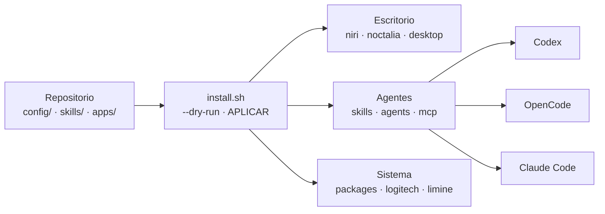

<div align="center">
  <h1>CorvoSetup</h1>
  <p><strong>Mi escritorio CachyOS + Niri y mi entorno de agentes de IA, versionados y restaurables con un comando.</strong></p>
  <p>
    <a href="https://github.com/FernandoValdes01/corvosetup/actions/workflows/checks.yml"></a>
    
    
    <a href="LICENSE"></a>
    
    
  </p>
  <p><a href="#inicio-rápido">Inicio rápido</a> · <a href="#qué-incluye">Qué incluye</a> · <a href="#módulos">Módulos</a> · <a href="#seguridad">Seguridad</a> · <a href="docs/restore.md">Restauración</a> · <a href="docs/agents.md">Agentes y skills</a> · <a href="docs/security.md">Privacidad</a></p>
</div>

CorvoSetup guarda lo que hace que mi equipo sea mío: el escritorio Niri con vidrio y blur, la terminal, los atajos, y un entorno completo para trabajar con Codex, OpenCode y Claude Code. No es un respaldo del HOME. Es un snapshot público, revisado a mano, que se aplica por módulos y nunca toca credenciales.

## Qué incluye

- **Escritorio Niri.** Configuración portable, panel Noctalia, Alacritty, Fish, atajo de capturas y Niri Display Settings traducido al español.
- **Tres clientes de IA, una sola biblioteca.** 37 skills viven en `skills/` y se enlazan a Codex, OpenCode, Claude Code y `~/.agents`. Nada de tres copias que se desincronizan.
- **Nueve servidores MCP.** Draw.io, JFLAP, Packet Tracer, FilmCraft (video), PhotoCraft y LightCraft (foto), Scrapling, Firefox personal y YouTube Research.
- **Restauración segura.** Cada módulo tiene `--dry-run`, pide escribir `APLICAR` y rechaza ejecutarse como root.
- **Cero secretos.** gitleaks revisa los archivos y el historial completo en cada push.

## Inicio rápido

```bash
git clone https://github.com/FernandoValdes01/corvosetup.git
cd corvosetup
bash install.sh --only skills --dry-run   # mira qué haría
bash install.sh --only skills             # aplícalo
```

El modo normal muestra un resumen y espera `APLICAR`. No lo ejecutes con `sudo`.

Orden mínimo para una máquina nueva que no necesita cambios de arranque: `skills`, `mcp`, `agents`, y después `desktop`, `niri` o `noctalia` según el entorno. El módulo `limine` queda fuera de ese flujo.

La restauración no instala todo el software externo. Revisa los requisitos en [docs/restore.md](docs/restore.md) antes de aplicar más módulos.

## Cómo funciona



Las plantillas usan `@HOME@` en vez de rutas reales. El restaurador las renderiza para el usuario de destino y fusiona las preferencias públicas con la configuración local, sin pisar claves ni credenciales ajenas.

## Módulos

Usa `bash install.sh --only MODULO`. Sin `--only`, recorre los módulos en este orden:

| Módulo | Función |
| --- | --- |
| `packages` | Instala los paquetes de Arch/CachyOS del setup. |
| `limine` | Genera la configuración de arranque con datos del equipo y la sincronización Snapper. No modifica Secure Boot. |
| `logitech` | Instala Logitech Light Manager, su servicio de usuario y la regla udev. |
| `niri` | Restaura el snapshot portable, Niri Display Settings en español y el atajo de capturas. |
| `noctalia` | Instala la configuración, el plugin Codex local y la fuente Monocraft. |
| `desktop` | Restaura Alacritty, Fish, ajustes de T3 Code, lanzadores y la unidad de notificaciones T3. |
| `skills` | Copia 37 skills a la biblioteca local y crea los enlaces de cada cliente. |
| `agents` | Fusiona perfiles y configuración de Codex y OpenCode, más los MCP y `CLAUDE.md` de Claude Code. Instala las CLI fijadas solo si falta alguno de los clientes. |
| `mcp` | Instala los nueve servidores MCP y sus lanzadores. Guías de [video](docs/filmcraft.md) y de [fotos con referencias](docs/photocraft.md). |

## Estructura

| Ruta | Contenido |
| --- | --- |
| `apps/` | Logitech Light Manager y el código de los servidores MCP JFLAP y Firefox personal. |
| `config/` | Snapshots de `niri`, `alacritty`, `fish`, `noctalia`, `t3code`, `codex`, `opencode`, `claude`, `agents`, `skills` y `mcp`. |
| `skills/` | Biblioteca común de 37 skills con sus recursos. |
| `scripts/` | Un instalador por módulo, el restaurador de agentes, las verificaciones y los lanzadores MCP. |
| `patches/` | Parche de idioma de Niri Display Settings. |
| `tests/` | Comprobaciones estáticas y pruebas de regresión. |
| `docs/` | Guías de restauración, agentes y seguridad. |

## Seguridad

Un repo de configuración público se rompe por un solo token. Por eso:

- Las listas de archivos son explícitas. Lo que no está en la lista no se captura.
- `scripts/check-secrets.sh` y gitleaks revisan los archivos y todo el historial de Git, en local con un hook versionado y en CI.
- Los destinos con padres simbólicos se rechazan, y los archivos con credenciales quedan en modo `0600`.
- Cada módulo exige `CORVOSETUP_AUTHORIZED` y respeta `CORVOSETUP_DRY_RUN`.
- Las pruebas del instalador corren con un HOME temporal. Nunca contra el escritorio real.
- Nunca se copian credenciales, sesiones, historiales, bases SQLite, backups ni rutas a proyectos de confianza.

Detalles y límites conocidos en [docs/security.md](docs/security.md).

## Qué configurar en cada PC

- **Monitores.** Los perfiles quedan fuera del snapshot. Niri conserva tu `cfg/display.kdl` local y solo instala la plantilla si falta. Mira `niri msg outputs` para ajustarlo.
- **Notificaciones de T3 Code.** El módulo `desktop` instala el servicio pero no lo activa. Con T3 Code instalado: `systemctl --user daemon-reload && systemctl --user enable --now t3code-notify.service`. El monitor lee la base local en solo lectura y no la copia.
- **Vidrio.** T3 Code usa opacidad `0.86` y blur de Niri, que necesita una versión con soporte de blur. Alacritty usa opacidad `0.7`. Las versiones de `packages/current-versions.txt` son referencias del snapshot, no un pin.
- **Autenticación.** Codex, OpenCode y Linear piden login otra vez, y los conectores remotos se reactivan por equipo.

## Verificar y modificar

```bash
bash tests/static-checks.sh        # sintaxis, restauración y regresiones
bash scripts/check-secrets.sh      # archivos públicos
bash scripts/check-secrets.sh --history
```

Los tests MCP necesitan las dependencias de `config/mcp/jflap-requirements.txt` y `PYTHONPATH=apps/jflap-mcp`. Activa los hooks en cada clon con `git config core.hooksPath .githooks`.

Para cambiar el setup, edita los archivos del repo, revisa `git diff`, prueba el módulo afectado y corre los chequeos. No hay sincronización automática desde el equipo. El `push` es siempre una decisión mía.

## Licencia

[MIT](LICENSE). Los servidores MCP y skills de terceros conservan sus propias licencias. La skill `brag` se publica sin música ni efectos de sonido por la misma razón.
